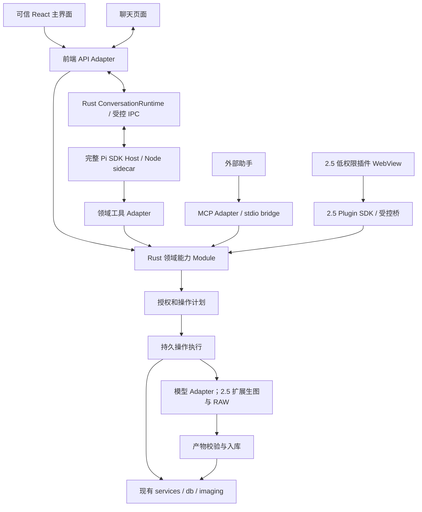

# 架构说明

> 更新日期：2026-09-23
>
> 本文档描述代码当前实际结构和不可违反的设计约束。数据库、搜索、分面和 AI 协议变化时，必须同步更新本文及相关契约。

## 1. 总览

```text
React 19 + TypeScript
pages -> stores -> api -> Tauri invoke/events
                              |
                              v
Rust commands -> services -> db
                     |
                     +-> filesystem / image / video / HTTP / Ollama
```

目标不是“薄应用”，而是让每一层只承担一种责任：

- `pages/` 负责页面编排和组合。
- `stores/` 负责跨组件状态和动作。
- `api/` 是所有 Tauri 调用的唯一前端入口。
- `commands/` 负责 IPC 参数、锁、事件和异步边界。
- `services/` 负责可测试的业务逻辑。
- `db/` 负责 SQL、事务和迁移。

当前新增 `src-tauri/src/contracts/` 保存 Agent 边界类型，机器枚举由 `docs/contracts/agent-v1.json` 同源生成 Rust 与 TypeScript，并由 tooling 检查漂移。该模块目前不提供业务执行或授权；实现范围与未完成项见 [Agent v1契约](contracts/agent-v1.md)。

## 2. 前端结构

### 2.1 页面

| 页面 | 文件 | 职责 |
|---|---|---|
| 入库 | `src/pages/ImportPage.tsx` | 待入库清单、改名、托管选项、导入任务 |
| 素材库 | `src/pages/LibraryPage.tsx` | 网格、筛选、批量操作、对话框和查看器入口 |
| 超级搜索 | `src/pages/SuperSearchPage.tsx` | 三区条件、AI 搜索、警告、诊断和结果网格 |
| 打标 | `src/pages/AiTaggingPage.tsx` | 批次、主图/胶片条、建议确认、标签编辑 |
| 设置 | `src/pages/SettingsPage.tsx` | AI 连接、本地模型、入库、外观、数据与恢复 |

全局导航由 `src/App.tsx` 和 `src/components/layout/BottomBar.tsx` 管理。查看器打开时隐藏底栏。

### 2.2 状态层

`src/stores/` 当前包含：

- `libraryStore`：素材列表、筛选、分页、查看器上下文和刷新。
- `selectionStore`：选择集合、范围选择、截断信息。
- `tagStore`：标签树、分面和治理状态。
- `aiStore`：批次、建议、进度和确认状态。
- `settingsStore`：设置加载、串行持久化、外观预览、主题和错误状态；设置页只在用户实际改值后安排自动保存。
- `taskStore`：导入、导出、AI 等全局任务进度。
- `superSearchStore`：SearchPlanV3、AI 合并、持久化和诊断。
- `metadataStore`：元数据筛选项和派生值。
- `numericDomainStore`：数值分面范围和类型信息。
- `platformStore`：后端静态平台能力的单一前端消费入口。

跨页核心状态不得放在页面局部 state 中，也不得复制到第二个 store。

### 2.3 API 层

`src/api/` 按域拆分：

- `client.ts`：统一 invoke 和错误封装。
- `assets.ts` / `thumbnail.ts` / `preview.ts`
- `import.ts` / `export.ts` / `video.ts`
- `ai.ts` / `connections.ts` / `ollama.ts`
- `platform.ts`：静态平台能力 IPC。
- `tags.ts` / `settings.ts` / `superSearch.ts`

约束：

1. 页面和组件不直接 import `invoke`。
2. Rust serde 字段变化必须同步 `src/types/`。
3. 事件监听集中在 hooks/api 封装，组件负责卸载和清理。
4. `src/utils/logger.ts` 是唯一允许直接调用 `invoke` 的例外：日志必须使用原始
   `@tauri-apps/api/core`，不能经过 `src/api/client.ts`，否则 IPC 失败会递归触发日志。
   它只承载前端日志回传，不承载业务命令。

### 2.4 主要组件域

| 目录 | 内容 |
|---|---|
| `components/common/` | Modal、ContextMenu、Button、ModelCombobox、错误边界、进度条 |
| `components/layout/` | TitleBar、BottomBar |
| `components/library/` | 网格、卡片、侧栏、标签树、元数据、颜色条、查看器入口 |
| `components/viewer/` | 全屏查看器、媒体视口、胶片条、信息栏、标签栏 |
| `components/supersearch/` | AI 搜索、QueryBuilder、条件 chips |
| `components/ai/` | Filmstrip、Workbench、进度和分面标签输入 |
| `components/settings/` | AI 连接、分面、治理、本地模型和服务管理 |
| `components/media/` | 视频播放器和播放控件 |

复杂组件应按职责拆分。拆分必须先移动、后改行为，不与功能修复混在同一批。

## 3. Rust 后端结构

### 3.1 commands 层

`src-tauri/src/commands/` 按域组织：

- `assets_cmd`、`thumbnail_cmd`、`media_cmd`
- `import_cmd`、`export_cmd`
- `tags_cmd`、`super_search_cmd`
- `ai_cmd`、`ai_connections_cmd`
- `ollama_cmd`、`settings_cmd`
- `observability_cmd`：前端日志回传和脱敏诊断包导出

commands 只允许：

- 解析和校验 IPC 参数。
- 获取 `AppState`、短锁读状态。
- 把耗时任务放到 `spawn_blocking` 或后台线程。
- 发 Tauri 事件。
- 调用 services/db 并映射错误。

commands 不允许：

- 直接拼业务 SQL。
- 在数据库锁内执行网络、解码或大文件 IO。
- 承载可独立测试的复杂业务逻辑。

### 3.2 services 层

| 模块 | 职责 |
|---|---|
| `imaging.rs` | 全局图片解码入口、策略链、尺寸探测、并发许可 |
| `thumbnail.rs` / `preview.rs` | 双层缩略图和待入库预览瘦壳 |
| `importer.rs` | 扫描、哈希、改名、托管、元数据和落库管线 |
| `exif_meta.rs` | EXIF 提取与 RAW 元数据兜底 |
| `video.rs` / `video_proxy.rs` | 视频元数据、抽帧、兼容代理 |
| `backup_restore.rs` | 备份暂存、验证、主库交换、旧库保底和恢复失败回滚编排 |
| `authorization.rs` | 可信主体构造、目录授权、会话/授权/库世代校验和受控文件/素材句柄 |
| `plans.rs` | 准备计划、可信 GUI 批准与原子 submit：校验主体/库/世代并在短事务消费批准登记操作 |
| `operations.rs` | 操作队列声明与释放、逐项收据、取消/恢复、子任务绑定和启动对账 |
| `conversations.rs` | 会话索引、持久草稿、附件可用性与显式 plan/operation/batch 交接投影 |
| `import_prepare.rs` | 导入准备：把扫描/检查固化为带指纹、分类与改名预览的计划，不做副作用 |
| `import_execute.rs` | 按已受理 operation 可靠执行导入：逐项收据、重复映射、取消与恢复跳过 |
| `platform.rs` | 编译目标静态能力 DTO；不做运行时健康探测 |
| `export_local.rs` | 复制/移动、目录布局、CSV 和任务状态 |
| `dedup.rs` / `perceptual.rs` | 文件哈希去重、dHash、相似图和同源关系 |
| `palette.rs` | 主色提取、色板状态和回填 |
| `kinship.rs` | 同源/连拍关系判定 |
| `media_refill.rs` | 存量媒体元数据、GPS、尺寸和色板回填 |
| `ai_cloud.rs` | OpenAI 兼容/Anthropic 请求、解析、批次执行、取消和重试 |
| `super_search_ai.rs` | SearchIntentV2、Schema、降级、守卫和解析 |
| `ollama_setup.rs` / `ollama_installer.rs` / `ollama_runtime.rs` | 检测、推荐、拉取、安装和服务生命周期 |
| `credentials.rs` | 系统凭据读写 |
| `agent_runtime/` | 应用拥有的 Pi Host 进程、受控 framing、版本握手、精确事件校验、会话归属与关闭/恢复；首期仅 Windows x64，运行资源离线且无业务工具 |
| `heic_decode.rs` / `raw_decode.rs` | imaging 的专用解码下游 |

后台外部进程统一通过 `utils/process.rs` 构造；Windows 使用无控制台标志，其他平台保持原生命令行为。版本/GPU健康探针使用有限时的双管道读取，超时终止并回收子进程；媒体抽帧与转码保留各自取消/超时控制。
维护页通过 `ollama_installer_cache_info` 只读安装包文件元数据，不复用包含版本子进程与本机 HTTP 请求的 `ollama_install_status`。缓存读取失败不返回空缓存假成功。

`error.rs` 是命令错误的统一序列化边界：`AppError` 返回 `{ code, message, cause? }`。
`code` 使用稳定的机器码，业务校验优先使用 `invalid_arg` / `not_found` / `conflict` /
`cancelled` / `timeout` / `file_locked` / `ai_rate_limited` / `unauthorized` /
`unsupported` / `internal`；`cause` 保留 thiserror 的底层 source，前端 `AppError`
会同时保留 `code`、`message` 和 `cause`，用于差异化提示和排障。

根模块 `src-tauri/src/observability.rs` 负责统一日志初始化和安全边界：

- 同时输出到 stdout 和 `data_dir/logs/app.log.*`，文件 writer 使用非阻塞队列；启动后清理
  过期日志并把 `app.log*` 总量压到 50 MB 以内，始终保留最新文件。
- 安装 panic hook；同步写入 `fatal.log`，保证启动期和异步队列未刷盘时仍有证据。
- 提供 `info` / `debug` / `trace` 运行时级别切换，设置值落库后热生效。
- 对前端回传的 message/context 做长度限制和高置信度凭据脱敏。
- 导出诊断包时只读取摘要和日志文件，不读取素材原文件、提示词或完整请求体；日志总量上限
  20 MB、单文件上限 4 MB，超限时保留最新文件的尾部并在摘要中标记 `truncatedLogs`。

### 3.3 db 层

| 模块 | 职责 |
|---|---|
| `migrations.rs` | 版本迁移、幂等修复、schema 初始化 |
| `schema_features.rs` | 可选约束能力登记和实际结构自检 |
| `assets.rs` | 素材 CRUD、筛选、排序、分页 |
| `search.rs` | FTS5/LIKE 原子谓词 |
| `search_query.rs` | 元数据字段和运算符白名单编译 |
| `query_expr.rs` | QueryExpr 布尔树编译 |
| `search_plan.rs` | SearchPlanV3 校验、编译、评分和诊断 |
| `tags.rs` / `tag_facets.rs` / `facet_numbers.rs` | 层级标签、分面和数值分面 |
| `asset_tags.rs` / `tag_ops.rs` | 标签关联和撤销流水 |
| `ai.rs` / `ai_connections.rs` | AI 批次、建议和独立用途连接绑定；Agent 用途规则见 [实现契约 §6](../plans/v2/12-implementation-contracts.md#6-模型与个人流程) |
| `settings.rs` | 设置 JSON、normalize 和兼容迁移 |
| `authorization.rs` | 主体授权世代、目录授权和 opaque handle 的幂等持久结构 |
| `plans.rs` | 计划/批准/操作的幂等持久结构与原子批准消费 |
| `operations.rs` | 操作步骤/项目/收据/子任务绑定/恢复摘要的幂等持久结构与原子状态推进 |
| `conversations.rs` | 会话/草稿/附件/交接链接的幂等持久结构；不存第二份 transcript |
| `import_plans.rs` | 导入准备计划与逐项候选（指纹/分类/改名预览/剔除）的幂等持久结构 |
| `export.rs` / `dedup.rs` / `backup.rs` / `video_proxy.rs` | 任务和持久化模型 |

### 3.4 AppState

`src-tauri/src/state.rs` 统一持有：

- SQLite 连接。
- 取消注册表。
- 缩略图/媒体相关共享状态。
- Ollama runtime 状态。
- schema capability 缓存。

服务层尽量接收纯参数或 `Connection`，避免与 `AppHandle` 耦合；事件发送留在 commands。

## 4. 数据库与迁移

### 4.1 版本模型

- `PRAGMA user_version` 当前推进到 V22。
- V23 色板关系表、V24 数值分面、V25 在线连接限额字段和 V26 视频代理指纹采用无条件幂等修复，不推进 `user_version`，存量库每次启动可自愈补齐；V26 只追加列，不修改已发布的 V14 代理表迁移。
- 已发布迁移禁止修改，只能追加新迁移或幂等修复。
- 新列只追加到表尾，读取使用列名映射，禁止依赖物理位置。

### 4.2 关键数据原则

- 设置表只有一个业务 key：`app_settings`，内容为完整 JSON。
- `tag_facets` 是分面唯一事实源，旧 JSON 配置只作为历史迁移输入。
- `tag_terms` 与 `tag_aliases` 的唯一约束由 `schema_features` 控制，禁止双写。
- 回收站通过 `assets.deleted_at` 软删实现。
- 标签操作流水用于批次撤销；手工覆盖应清理批次来源，避免误撤销。
- RAW/非 RAW 同源组只有在整组恰好包含一个 RAW 和一个非 RAW 时才互相折叠；有缺失、重复或第三个成员的歧义组不自动扩散标签、数值或去重结果。
- 视频代理只有在源素材指纹、编码器版本、工具指纹与源路径均匹配时才可复用；旧记录的指纹为空时视为陈旧缓存并重建，不影响原始素材。
- 运行时 keyring IO 由 `services/credentials.rs` 协调：先拿凭据操作锁，再短暂读写 DB 元数据，释放 DB guard 后才触碰系统凭据；不持有该锁跨网络请求。更新/删除与 DB 失败时必须恢复旧凭据或明确报告补偿失败。
- V15 旧设置凭据迁移只在 `Database`/`AppState` 创建前的启动 bootstrap 执行；凭据写入失败时保留旧 JSON，运行时 commands 不得复用此例外。
- 外部工具直接改库前必须了解 FTS 触发器和自定义 `cjk_bigram` 依赖。普通 SQLite 客户端只适合 SELECT。

### 4.3 备份与恢复

- 备份使用 SQLite `VACUUM INTO` 生成单文件快照。
- 恢复前校验来源并在数据目录同卷暂存、复验；暂存失败时活动库保持不变。
- `Database` 普通访问先取得 lifecycle 读门再短暂锁连接；恢复取得独占 lifecycle 写门，阻止其他命令访问半交换状态。连接 mutex 只用于 checkpoint/close、短 SQL 守卫和替换连接，不能跨复制、rename 或迁移文件 IO。
- 将现库保留为 `library.db.old` 后再安装恢复副本。若该路径已有内容则拒绝恢复，不覆盖、不删除；成功恢复后仍保留 `.old`，需人工确认后才能为下一次恢复腾出该名称。
- 运行中的导入、导出或打标任务存在时拒绝恢复。
- 获得独占门后再次检查任务状态，再执行文件交换与 `db::init` 迁移/自检。
- 替换或重新打开失败时先保留失败副本并从 `.old` 复制回主库；若不能证明活动库有效，封锁后续 DB 命令。若主库缺失，启动时只从校验通过的 `.old` 原样复制恢复，绝不静默创建空库，也不删除 `.old`。

## 5. 关键机制

### 5.1 图像与缩略图

所有通用图片解码经 `services/imaging.rs`：

1. 读取尺寸或内嵌预览。
2. 尝试 TIFF/CR3 等容器预览。
3. 必要时进入 `heic_decode` 或 `raw_decode`。
4. 使用全局许可限制并发。

占位层优先快速预览，禁止对 RAW 做昂贵全解码。高清层按需生成并缓存。dev 和 release 的图像依赖必须保持合理优化配置，新增图像依赖要核对 `Cargo.toml`。

平台能力由 `services/platform.rs` 单一计算，前端只消费 `platformStore`，不直接探测操作系统。
FFmpeg/FFprobe 发布构建只从主程序相邻且通过版本探测的 Tauri sidecar 启动，缺失/不可用时失败关闭，不回退任意系统 `PATH`；仅开发构建允许 `PATH` 回退。代理复用必须核对源素材指纹、源路径、编码器策略版本和工具指纹。源素材指纹在数据库锁外基于导入 hash（如有）、文件大小、修改时间及首尾固定大小样本计算；它用于缓存失效判断，不等同于完整内容校验和。代理容器由后端
能力选择（Windows/macOS H.264/MP4，Linux VP8/WebM）。来源、目标二进制和许可证材料摘要由
`src-tauri/binaries/manifest.json` 锁定，打包入口统一为 `scripts/desktop.mjs`。

### 5.2 普通搜索

普通素材库查询由 `AssetFilter` 表达：

1. `search.rs` 生成 FTS5/LIKE 原子谓词。
2. `search_query.rs` 编译元数据条件。
3. `assets.rs` 组合筛选、排序和分页。

FTS5 使用独立内容表和触发器同步，自注册 `cjk_bigram` 处理中文。查询必须参数化，不能把所有命中 ID 拉回 Rust 再拼长 IN。

### 5.3 超级搜索

超级搜索的机器协议由 `SearchPlanV3` 统一：

- `filter`：必须满足。
- `should`：软排序，数组顺序就是优先级。
- `mustNot`：只存正向条件，由计划层统一取反。
- `ranking`：字段排序或 relevance。

列表、总数、全选 ID 和诊断必须走同一计划编译器。详情见 [contracts/search-plan-v3.md](contracts/search-plan-v3.md)。

AI 解析先形成 `SearchIntentV2`，再由后端转为受限查询结构。AI 不生成 SQL、tagId、分页或物理执行计划。详情见 [contracts/super-search-ai-v2.md](contracts/super-search-ai-v2.md)。

超级搜索显式用途绑定优先且只使用绑定连接；无绑定时由 `services/credentials.rs` 自动解析可用在线连接，不读取旧版默认档案，也不自动回退本地模型。解析失败会保留为可操作错误，不切换到另一条服务。设置页通过无凭据的状态命令展示后端实际解析结果；用户仍可显式绑定本地服务。

- 标签词典在每次 AI 搜索请求时从活动标签和可搜索别名实时读取，并附带父类路径；人工确认后的新词无需重启即可被后续搜索识别。
- 精确规范名/别名直接解析为标签；无法可靠映射但置信度达到阈值时降级为内容搜索，低置信度概念给出未采用 warning。

### 5.4 标签与分面

- 标签父子关系使用递归逻辑和安全检查，禁止环。
- 分面 key 是机器协议，显示名只用于 UI 和提示词。
- `input_mode` 决定分面是否进入 AI 提示词。
- 新库、重置标签和空标签恢复库会播种 `subject` / `scene` / `people` 的默认层级；父节点用于浏览和宽泛筛选，AI 输出叶子。
- AI 确认的新词按已选择分面创建；系统不再把核心分面新词自动归入「其他」，需要层级整理时由用户通过现有标签治理入口调整。
- 创建与编辑通过 `FacetSaveInput` 一次提交；`services::facets` 校验业务字段，`db::tag_facets` 在一个 SQLite 事务中保存配置。
- 手工覆盖标签时清理批次来源，保证撤销安全。
- 删除分面按契约顺序级联清理标签、关联、建议和流水。

详情见 [contracts/facets-v2.md](contracts/facets-v2.md)。

### 5.5 AI 打标

批次状态：

```text
pending -> processing -> done
                  |
                  +-> cancelled
                  +-> interrupted（重启后修复）
```

规则：

- done/cancelled/interrupted 可续跑剩余 pending。
- processing 不允许重复启动。
- 单条失败只标记该项，不阻塞整批。
- 空解析视为失败，不写成空标签成功。
- 视觉输出使用 `description`、`tags`、`numbers` 协议；`peoplePresence` 只作为旧结果的可选兼容字段读取，不再要求模型提供或参与新结果语义。
- 分面 key 只承担结构路由；业务说明来自设置界面可编辑的全局打标说明和各分类“给 AI 的分类说明”。数量、范围等机器约束由同一界面的单选/多选、上限和数值配置动态生成。
- 解析层校验 JSON 结构、可用性与当前可见的分类配置，不按固定主体/场景/人物语义补标签、删标签、截断描述或重写模型输出。
- `confidenceMinSuggest` 控制建议进入待确认列表的最低置信度；待确认建议经用户确认后才写入素材。
- 请求层优先使用结构化输出：本地 Ollama 原生 JSON Schema、OpenAI 兼容 `json_schema`、Anthropic tool use；不可用时按批次缓存并降级为 `json_object` 或纯文本。
- 无效 JSON、必需结构字段缺失或完全没有可用内容时最多做一次协议修复；描述长度、主体是否存在和人物标签一致性不作为后台隐式规则。
- 低于 `confidenceMinSuggest` 的标签直接拦截，其余建议全部保持 pending，确认后才写正式标签。
- 续跑以是否已有分析结果为判断依据，不把低置信度全被拦截或纯描述结果误判为未处理。
- 批量确认按页提交并在页间释放数据库锁，避免整批建议形成长时间单一写事务。
- 视频多帧结果按证据合并，保留合并标签的置信度；失败帧记录 warning，单帧噪声不直接进入建议。
- 打标工作台支持手工复核和计划驱动的 AI 执行。`services::tagging` 负责将计划操作接入 AI batch，`services::ai_cloud` 执行供应商请求；AI batch 是建议与执行状态的事实源，operation 保存编排关系。冻结范围、批准、预算、取消和并发回写规则见 [实现契约 §4.4](../plans/v2/12-implementation-contracts.md#44-ai-打标计划与外发)。
- Tauri 启动命令只接收 operation/step 标识，由 `services::tagging` 校验调用者与绑定关系后交给执行服务；新旧入口和计划新鲜度约束见 [实现契约 §4.4](../plans/v2/12-implementation-contracts.md#44-ai-打标计划与外发)。
- 批次、tagging link、operation step 和 operation 的中断/取消及启动恢复状态在数据库事务内同步；失效审批重计划时旧操作明确取消、未完成批次回到 pending，再创建需重新批准的新范围。终态写入失败会整体回滚，避免只改批次状态。

### 5.6 日志、前端异常与诊断

- 后端业务代码只记录结构化事实，不在模块内自行创建文件 appender、过滤器或第二套日志器。
- AI 打标批次日志使用 `operation = "ai_tagging"`，并带 `batch_id`、`asset_id`、`stage`、
  `error_code` 与可确认的 `http_status`；不记录完整响应体，避免把模型原文或凭据带入日志。
- 前端统一通过 `src/utils/logger.ts` 记录 `debug` / `info` / `warn` / `error`；生产 WebView
  控制台通常不可见，异常通过 `log_frontend` 回传 Rust。
- 每条前端日志由 logger 写入不可被业务上下文覆盖的 `sessionId` 和递增 `sequence`；每次
  `src/api/client.ts` invoke 生成唯一 `requestId`，失败日志同时带 `command`、`durationMs`
  和 `cause`，用于把一次 IPC 失败与前后端上下文关联起来。
- 全局捕获 `window.error` 和 `unhandledrejection`。回传失败不得反向制造业务失败。
- 日志可包含路径、命令名、任务 ID、阶段和错误摘要；不得记录完整 API Key、Authorization、
  用户提示词、完整请求体或素材内容。
- 日志按天滚动，保留 30 个文件，并在启动时清理过期文件、把总量控制在 50 MB 内。
  `fatal.log` 是启动失败和 panic 的同步兜底证据。
- 诊断包包含 `diagnostics.json`、`logs/app.log*`、`fatal.log` 和存在的 `panic.log`；摘要仅含
  版本、系统、schema、数量、日志级别和最近 AI 批次状态；日志收集上限为总量 20 MB、
  单文件 4 MB，超限尾部截断并在摘要中记录。数据库锁只在读取摘要时短暂持有。

### 5.7 删除、导出和恢复

- 软删：保留文件，写入 `deleted_at`。
- 彻底删除：删除文件成功后才移除或更新数据库记录。
- 设置页“原始素材文件”重置复用彻底删除流程，覆盖在库与回收站；删除失败的文件保留素材记录并回报失败数量。
- move 导出：文件移动成功后同步素材路径。
- 所有批处理都要区分成功、失败、重复和取消。
- 失败必须保留可恢复信息，不允许 UI 假成功。

## 6. 状态流

| 链路 | 流程 |
|---|---|
| 入库 | ImportPage -> import API -> command -> importer -> db/预览 -> 事件 -> taskStore |
| 缩略图 | Thumbnail -> api -> command -> thumbnail -> imaging -> 缓存 |
| 普通搜索 | LibraryPage -> libraryStore -> assets API -> AssetFilter -> db |
| 超级搜索 | SuperSearchPage -> superSearchStore -> SearchPlanV3 -> command -> db |
| AI 搜索 | AiSearchBar -> ai_parse_search_query -> SearchIntentV2 -> QueryExpr/SearchPlan |
| AI 打标 | 选图 -> 建批 -> 执行 -> 进度事件 -> 建议确认 -> 标签/FTS |
| 本地模型 | SettingsPage -> ollama API -> command -> installer/runtime/setup |
| 恢复 | SettingsPage -> backup API -> command -> 校验/替换/迁移/重启 |
| 分类重置 | SettingsPage -> settings API -> command ->（可选）原文件逐项删除 -> DB 事务/缓存清理 |
| 日志回传 | 前端 logger -> raw invoke -> observability -> 文件日志 |
| 诊断包 | SettingsPage -> exportDiagnostics -> command -> zip 摘要/日志文件 |

## 7. 设计约束

1. 前端不直连 invoke，commands 不写业务和业务 SQL。
2. 图片解码只有一个统一入口，专用解码器不能成为平行主链。
3. 数据库锁内不执行阻塞任务。
4. 所有输入路径必须校验，所有 SQL 必须绑定参数。
5. 所有破坏性操作都必须明确结果，禁止静默覆盖和假删除。
6. 已发布迁移不回改，schema 变化必须有恢复路径。
7. 搜索计划、分面 key 和 AI 意图是机器协议，改协议必须同步 Rust、TypeScript 和测试。
8. UI 只使用语义主题变量，状态不能只靠颜色表达。
9. 性能路径不引入第二个缓存或第二个事实源，除非契约明确。
10. 文档只保留当前事实，过程历史交给 Git。
11. 日志只能在统一可观测性边界内落盘；前端日志例外使用 raw invoke，且不得传递敏感原文。

## 8. 分发与许可

项目和组合安装包使用 GPL-3.0-or-later，许可全文见根目录 `LICENSE`，版权及第三方声明见 `NOTICE`。此前以 MIT 发布的代码保留原授权。公开分发必须随安装包提供对应源码与构建材料：

- `rawler` 及其 LGPL/GPL 许可条件。
- `heif-rs`、libheif、libde265、x265 等静态链接组件。三目标原生归档及源码/许可证 URL、SHA256 见 [`src-tauri/native/heif-manifest.json`](../src-tauri/native/heif-manifest.json)；x265 使用 GPL-2.0-or-later，在本组合分发中适用 GPLv3。
- 其他图像、视频或模型依赖的再分发条款。

源码归档必须包含本程序、静态库与独立 FFmpeg 程序的实际源码、所需补丁、构建脚本和依赖锁。仅有许可证文本和上游主页链接不能替代对应源码。商业使用允许；再分发程序或修改版本时须遵守 GPL 源码与许可义务。

## 9. 2.0目标架构（待原型验证与实现）

第9.1–9.6节描述目标结构，不能据此判断功能已接通；第9.7节起描述已落地的模块机制，实现缺口和验收状态只见 [项目计划](PROJECT_PLAN.md#9-20-agent开发状态)。已批准产品行为由 [PRD第8节](PRD.md#8-20-agent-与25插件的已批准目标待实现) 定义；精确字段与协议由对应冻结契约定义。标为2.5的Module/运行空间仅为后续设计，不在2.0创建；当前实现描述不构成放宽任务卡或冻结契约的依据。

### 9.1 系统拓扑



聊天消息、事件和控制均沿 React → src/api → Rust ConversationRuntime → Pi Host 传递；Pi 的业务工具回到同一 Rust 领域能力。图中的 Runtime 与 Domain 都在同一个 Rust 业务宿主内，前端不直连 Node。

### 9.2 Module 与 Interface

| Module | 稳定 Interface（示意） | 隐藏的复杂度 |
|---|---|---|
| ConversationRuntime | prompt / subscribe / stopReasoning / restore | Pi 类型、队列、会话切换、压缩、版本兼容 |
| DomainCapabilities | 按域定义的 query / prepare / submit | 参数、业务约束、身份、分页和错误 |
| Authorization | evaluate / requestReview / consumeApproval | 权限范围、配置变化、撤权和审计 |
| Operations | get / list / cancel / resumeEligible | 持久步骤、幂等、资源冲突、恢复核实 |
| ManagedLibrary | inspect / prepareMigration / relocate / reconcileLegacy | 单仓身份、托管范围、离线、迁仓与旧库外记录治理；维护入口不向 Agent 开放 |
| PersonalWorkflows | save / edit / instantiate / retire | 可编辑参数模板、版本、能力兼容与每次调用重新授权；不运行用户脚本 |
| PluginHost（2.5） | install / enable / openView / disable | 包验证、版本、WebView、工作区和撤权 |
| Artifacts（2.5 媒体扩展） | create / validate / register | 暂存、格式、来源关系；2.0 仅先做实际导入所需收据 |
| ConnectorRegistry（分期） | describe / invokeApproved / getHealth | 2.0 仅落实模型实际所需能力；媒体及通用扩展后续增加 |

采用小 Interface 封装复杂 Implementation；真正变化的 Seam 是 Pi/MCP/插件入口、模型提供方及媒体引擎。不要创建“任意名称+任意 JSON 执行一切”的万能业务接口。底层 IPC 可以统一封包，业务仍有类型和明确动作。

### 9.3 一份能力定义，多个 Adapter

每个能力定义稳定 ID、契约版本、输入/输出 schema、所需权限、资源范围、副作用类别、大小限制、取消/重试语义和可见入口。Rust 执行层拥有最终校验权；2.0 对齐 TypeScript 类型、Pi 工具描述和 MCP schema，2.5 再增加插件 SDK 包装，契约测试防止漂移。表中统一使用 prepare→planId→submit，preview 只是计划的展示，不是另一种受理阶段。

首批能力示例：

| 能力 | 输入 | 输出 |
|---|---|---|
| assets.search | 经校验搜索意图/计划、分页 | 有界摘要、计数、selectionRef |
| imports.prepare | directoryHandle、collectionRef、选项 | planId、摘要、需要确认内容 |
| imports.submit | planId、提交幂等键 | operationId |
| tagging.prepare | selectionRef、连接/分类设置 | planId |
| tagging.submit | 已批准计划 | operationId、batchRef |
| exports.prepare/submit | selectionRef、目的目录句柄、复制布局 | planId / operationId |
| assets.move.prepare/submit | selectionRef、当前总仓内目标分库 | planId / operationId |
| assets.trash.prepare/submit | 精确素材集合 | planId / operationId |
| trash.empty.prepare/submit | 当前回收站中可安全清理的固定集合 | 独立 planId / operationId；不接受任意路径永久删除 |
| artifacts.register（2.5） | 已校验产物引用、目标分库 | 逐项资产收据 |
| operations.get/cancel | operationId | 真实状态/取消请求结果 |

句柄由宿主签发，引用不等于授权。审批绑定和执行语义统一见 [06](../plans/v2/06-permissions-and-data-safety.md)。正式标签写入不得借通用标签接口绕开 AI 建议确认。

### 9.4 数据所有权

| 数据 | 所有者 | 其他部分如何使用 |
|---|---|---|
| 素材、标签、FTS、配方与来源关系 | Rust/SQLite 业务内核 | 使用业务 Interface |
| 已批准计划、操作编排状态与关联 | Rust 持久操作记录 | 通过 ID 查询，不相信聊天文字 |
| 总仓身份、定位、托管凭据与旧记录待处理状态 | Rust 管理的持久库目录和维护记录 | 路径展示不作为所有权证据；迁移细则见 06 |
| 导入草稿、会话附件引用和工作台关联 | 宿主持久记录，前端投影 | 同任务多视图共享；页面卸载不丢失，不同对话不共用单一清单 |
| 个人流程定义、参数 schema 与版本 | 应用管理的流程注册表 | Pi 按版本加载；不携带上次的操作批准 |
| 既有 AI batch/export 的领域执行状态 | 各域持久任务记录 | operation 读取投影并编排后续步骤，不双写独立执行进度 |
| Pi 原生 transcript 和压缩结构 | Pi SessionManager | 应用保存索引与格式版本，不镜像第二套规范上下文 |
| 插件工程/草稿 | 插件命名空间存储，由宿主管理 | 专属存储 API 和导出 |
| 缓存、临时产物 | 宿主空间管理 | 可恢复任务占用明确；不能清理仍在使用的产物 |
| 凭据、客户端配对 | 系统凭据库与宿主授权记录 | 只给连接引用，不给普通插件密钥 |

同一素材库只设一个业务宿主。MCP bridge/Pi/插件不另开主库；应用侧新增单实例及库所有权校验。不会因 stdio 启动多个 bridge 就创建多个数据库业务进程。

### 9.5 运行空间

目标逻辑布局如下，物理目录由平台路径模块决定，不硬编码用户路径。2.0 只创建实际使用的 agent/operations 空间，plugins 各目录留待 2.5，不创建空目录占位：

    应用数据/
      agent/sessions/                 Pi 会话
      plugins/packages/<id>/<version>/ 只读已安装代码
      plugins/data/<id>/              持久工程与设置
      plugins/cache/<id>/             可清理缓存
      operations/<operationId>/       输入引用、暂存和产物

权限并非由目录名字保证；普通插件经宿主访问，调用时验证身份/句柄/配额。可信原生扩展的真实 OS 权限另见 05/06。素材库根目录、主库、凭据目录与插件工作区分离。

### 9.6 并发与故障

- 模型流、搜索、缩略图和重计算设独立并发预算，不能因一个显影批次饿死浏览。
- DB 短事务；复制、解码、网络、keyring 与进程等待在 DB 锁外。
- 会话一次推理循环由其状态机控制；2.0 长业务任务默认排队，查询、浏览和聊天保有独立资源预算。任务内部逐图并发仍受所属域配置限制，不能把排队等同全应用单线程；所有入口共用冲突与维护门。
- 插件页关闭只结束交互实例；具有有效任务授权的宿主任务可继续。退出主应用时停止接新请求、请求取消并记录中断；不是默认后台常驻服务。
- Pi 崩溃恢复会话并查询已有操作，不能重放全部工具调用。插件崩溃不应丢失已接受的宿主任务。
- 进度通知可以合并/丢帧，终态必须可查询；有 requestId、operationId、sequence、schemaVersion；过期事件不能覆盖新状态。

### 9.7 总仓保护数据边界（A1-02）

`db/libraries.rs`保存单当前总仓定位与资产保护映射，追加V27幂等结构，不改旧assets主键或标签/历史关系。`libraries`以singleton=1约束唯一当前定位，library_id是稳定身份，library_epoch是不可复用随机令牌；普通启动不旋转世代，备份恢复安装和维护切换必须显式生成新世代。旧settings.library_root只承接初始候选，最终运行定位以此表为准；常规设置保存不能清空或替换已有根，首次候选经锁外检查、短事务CAS后建立带新世代的身份，已有根的更换与重新定位只走后续维护流程。

`managed_asset_locations`以asset_id关联原记录，保存观察到的路径/modified_at、当前库与世代、相对定位、文件身份、摘要和托管收据。缺映射也按未核验处理；结构迁移不遍历assets回填，新记录默认unknown。路径或观察版本改变撤销证据并刷新不可复用location_revision；分类成功也刷新修订，旧分类结果不能覆盖新结果。verified要求完整证据字段，但数据库字段存在不证明文件归属；只有受控服务经锁外IO和身份核验后可登记。根健康独立于资产分类：unconfigured/unverified/ready/offline/wrong_root；失联不批量归类为库外，缺文件不删元数据。

共享`VERIFIED_ASSET_SCOPE`固定使用SQL别名a，在分页/计数之前约束当前健康库、核验状态、世代和观察版本。分批核验用keyset取最多100项，包含缺映射旧记录与对当前库无效的旧verified证据，IO在锁外；回写pending分类同时比较库身份/世代/根身份、资产路径/版本与location_revision，单语句有条件登记/更新映射并刷新修订，拒绝过时快照及路径ABA。该接口不能将记录标为verified，拒绝改写当前有效verified；旧世代证据可在当前ready根快照下CAS降级并清掉旧证明，再由正式核验服务登记。恢复安装通过db::init_for_restore在Database独占生命周期边界内完成迁移与随机世代刷新，撤销根身份/ready后才replace_connection；成功恢复及重新开库的回滚路径均使用该初始化。普通init不旋转；启动时从library.db.old自动救回也在开放连接前刷新世代，后续普通重开保持该新世代。数据库trigger拒绝修改root_path/root_identity而不刷新epoch。

普通列表/搜索/分面、去重与ID解析、缩略图和视频代理、导出与AI取图、媒体回填/色板/哈希等批量写入、标签/数值/AI审核写回、设置根保存、备份恢复世代失效以及启动回收站GC均已接入有效范围或在受控维护边界内执行；受控导入在写入资产行的同一事务登记托管证据，失败回滚。工程校验不清除库外/未知记录的原元数据，离线根保留证据并失败关闭。当前边界仍是数据库级保护：文件身份核验到实际打开/删除窗口的OS句柄策略由A1-03提供受控打开和打开后复核；敌对同账户TOCTOU、平台专属无跟随句柄和三端证据仍按后续A6/PLATFORM验收，不能把路径字符串、无链接检查或本卡测试声称为OS沙箱。

### 9.8 目录授权与受控资源句柄（A1-03）

`services/authorization.rs` 统一从已验证 Adapter 身份构造 `CallerContext`；GUI 身份取自 `AppState` 本运行实例和 WebView 会话，Pi/MCP 未来 Adapter 只能从各自握手/配对结果构造，不能由工具输入提供 principal。`commands/authorization_cmd.rs` 只允许 GUI 调用 Rust 宿主原生目录选择器，前端和外部 Agent都不能提交任意目录路径来创建授权。

`db/authorization.rs` 在V27追加幂等结构：每个 principal 有可替换的 `grantEpoch`；`directory_grants` 记录用途、真实目录身份、本次/记住、有效期、授权世代和库世代；`resource_handles` 记录主体、session/instance、目录/文件/素材类型、用途、读写/外发 access mask、过期和身份证据。撤销单条或全部授权在同一短事务中标记 grant/handle 并提升 principal 世代，旧句柄随后失败关闭。

读取区分 `import_source`（read）与 `export_destination`（write + export）。目录分页、文件打开和托管资产打开都在短锁外执行 IO：先核验句柄主体/会话/用途/世代/库世代，再检查规范根、逐级链接/reparse、相对路径、打开后的文件身份/大小/观察时间和根内位置；长读取可在有界块间复核撤权。素材句柄还要求当前 `VERIFIED_ASSET_SCOPE` 的有效托管定位。`ResourceRef` 本身从不授予权限，服务不提供通用路径读写命令，也不把本地路径写入授权错误日志。

### 9.9 准备计划、批准与原子提交（A1-04）

`services/plans.rs` 与 `db/plans.rs` 把“等待审核的计划”和“已受理的执行任务”分开：`prepare_plan` 只由领域能力处理器调用，写入计划的确切能力、范围引用、主体/会话/实例、库身份与世代、授权世代、条目数、预算、期限和由这些字段派生的 `planHash`，返回 `planId` 与一次性的 `reviewRef`；等待审核期间不创建 operation、不持有数据库锁、不占用资源独占锁。计划一旦写入即为不可变事实，输入或配置变化只能生成新计划，旧计划与新范围的摘要不同。

只有可信 GUI 能批准：`PlansApprove` 的能力入口表限定 `Gui`，批准时必须同时给出对应计划的 `planId` 和 `reviewRef`，服务再次校验当前库就绪、库世代、授权世代与 `planHash`，并把计划从 `pending` 转 `approved` 且写入一条 `plan_approvals`。GUI 审核的是计划本身，不需要冒充创建计划的 Pi/MCP/GUI principal；计划保留原创建主体、session/instance，提交时仍由原主体且同一运行实例完成。模型文本、`approved:true`、外部客户端提示都不能创建这条记录；契约解码层已拒绝这些伪造字段。`trash.empty.submit`（`permanent_trash`）与普通整理（`ordinary`）的审核类别在计划里固定，不能互换或借一次普通批准清空。

`submit_plan` 接收当前领域快照并在单个短事务内完成：先校验主体、原 session/instance、当前库就绪与世代一致、计划未过期、授权世代未变；从当前能力、范围、服务修订、模型、条目数、摘要和预算重建 `planHash`，与准备时保存的 hash 不一致就使计划失效并返回 `PLAN_CHANGED`；随后按 `(principalId, libraryEpoch, capability, idempotencyKey)` 查询幂等键；消费唯一未消费且摘要匹配、且计划仍为 `approved` 的批准；登记 operation 并写回 `consumed_operation_id`。同键同计划返回原 `operationId`（`replayed=true`），同键异计划返回 `IDEMPOTENCY_CONFLICT` 且不消费第二个批准；缺少或已消费批准返回 `approval_required`，此时尚无 `operationId`。过期的计划或批准在判定时标记 `expired`；库世代变更、根切换或授权撤销（`grantEpoch` 提升）都会让旧计划无法消费旧批准。

`commands/plans_cmd.rs` 只暴露 GUI 的计划列表、审核批准与操作查询；submit 是领域接口，不作为外部 Agent 原始命令注册。真实导入、打标、导出与移动由各自领域服务消费计划，外部 Adapter 只能经已授权的 capability handler 进入，不能直接调用批准后执行的 GUI 命令。

### 9.10 可恢复操作队列与逐项收据（A1-05）

`db/operations.rs` 在 `db/plans.rs` 建表之后追加幂等结构：`operation_steps` 以 `(operationId, stepId)` 固定步骤身份，`operation_items` 以 `(operationId, stepId, itemId)` 固定逐项身份并保存状态/effect_state/输入指纹/目标，`operation_receipts` 以 receiptId 幂等记录每次修订的事件、文件/子任务引用和错误，`operation_child_tasks` 以 `(operationId, stepId)` 唯一绑定子任务并以 `(taskKind, taskId)` 防止同一子任务被跨步骤复用，`operation_recovery` 保存启动对账摘要。operations 表通过幂等 `ALTER TABLE` 追加 `finished_at`，不改已发布迁移。

`db/tagging.rs` 追加 `tagging_batch_links`，以唯一 operation/step、唯一导入来源 operation/step、已批准范围指纹及持久请求计数/截止点绑定 AI 批次；同一批次可由多个顺序完成、各自独立审批的素材范围共同处理。批准消费、operation/step、AI pending batch 与范围化子任务映射共用一笔数据库事务；链接状态与 operation 状态在启动、完成、中断及启动恢复中同步。每个获准素材在发送前同事务递增预算、把对应 operation item 标为 `running/unknown` 并写入发送授权收据；已发送请求在结果不明或重启后不会被自动重放。若模型建议及分析已落库、但成功收据尚未提交，启动会按冻结建议 ID 和素材 ID 核验后补齐成功收据；全部素材因此已知完成时同步终结 step、operation 和 batch。若没有待继续素材而仍有未知请求，则 operation 终结为 `outcome_unknown` 并保留不可继续的恢复摘要；显式继续剩余素材后，既有未知项仍保留在最终 operation 状态和恢复摘要中。仅旧记录只有批次级尝试数、且完全没有逐项记录时才作为一个未知项呈现。

`services/operations.rs` 提供操作层编排：`OperationQueue` 单槽按全局 FIFO 领取可自动派发的 `queued/ready`，并把队首推进到 `running/executing`；需要 GUI 显式启动的 AI `tagging.submit` 等待项不占槽，也不会挡住导入派发。用户显式启动打标时仍须持有同一队列槽位，并服从更早可派发工作的 FIFO。未声明时只读与聊天不被长任务阻塞；`register_item`、`record_item_state`、`bind_child_task`、`finish_operation`/`finish_cancelled` 只由持有该操作的主体会话调用，跨 principal/session/instance 与跨库世代失败关闭；`bind_child_task` 同键同任务幂等、异键返回 `RESOURCE_CONFLICT`，保证恢复时不重复创建 AI 批次/导出任务。`reconcile_startup` 把未完成操作置为 `interrupted/reconciling`、统计未知 effect 并写入恢复摘要，自动对账只呈现事实，`resume_operation` 需用户在可信界面显式继续后才回到 `queued`；取消只标记 `cancelling`，`finish_cancelled` 为每个终结项目修订写收据并保留已成功项，已产生副作用但尚不能确认完成的项目进入 `outcome_unknown`。逐项状态以收据与真实文件/DB 效果为准，不能用 processed 计数或事件代替。

`commands/operations_cmd.rs` 暴露 GUI 的取消、恢复和恢复摘要查询；`AppState` 持有进程内 `OperationQueue`，`lib.rs` 启动维护任务调用一次启动对账。导入由 A2 dispatcher 处理逐项恢复；AI 打标由 `services::tagging` 管理单一 batch 子任务，在启动对账后将已中断的子任务同步为可显式恢复状态。队列抽象测试不能代替各领域 worker 的真实副作用验证。

### 9.11 会话索引与持久工作台草稿（A1-06）

`db/conversations.rs` 追加 `conversations`、`conversation_drafts`、`conversation_attachments`、`conversation_links` 四张幂等结构表，不推进既有 `user_version`。Pi 原生 JSONL 仍是唯一上下文源：本层只保存可重建投影——标题、状态、草稿载荷、附件引用与显式的 plan/operation/batch 交接链接，绝不另存一份参与模型推理的 transcript。会话按 `principalId` 归属（GUI 主体稳定，不随每次运行的 WebView session 重建），因此重开应用后仍可读回；草稿以 `(conversationId, draftKind)` 为唯一键并带 `revision`。

`services/conversations.rs` 覆盖卡内行为：`create/list/get/rename/set_archived/delete` 都先校验主体与当前库健康并只暴露本人会话；`list` 的筛选只搜索可重建的标题投影，不搜索对话内容；`save_draft` 校验草稿种类与 JSON 对象载荷字节上限；`attach_asset` 只记录素材引用和当时显示名，读取时用 `VERIFIED_ASSET_SCOPE` 计算 `available`，缺失或未核验就显式不可用，绝不静默重新授权；`link` 是唯一的交接入口，`(linkKind, linkRef)` 唯一键保证同一任务只归属一个会话，手动任务不传会话也照常成立。`delete_conversation` 先查询该会话是否仍有未结束 operation，有则返回 `RESOURCE_CONFLICT`；否则只做软删除（`deleted_at`），素材、正式标签、计划、操作与收据一律保留。

`commands/conversations_cmd.rs` 暴露 GUI 的创建/列表/读取/改名/归档/删除/存草稿/加附件/交接命令；前端只经 `src/api/conversations.ts` 调用，`src/stores/conversationStore.ts` 按稳定 `conversationRef` 分桶保存草稿（切页/交替编辑两个会话不串清单），并在选中或重开时按该 ID 重新拉取投影重建，而不是依赖“最近一个”全局 ID。A1-06 只建立宿主会话索引与草稿基础；Pi transcript 关联、草稿字段的业务级校验和附件可访问性的真实素材 UAT 由 A3/A4 继续接入。

### 9.12 导入准备计划（A2-01）

准备、确认前复验、执行源文件复验及目录恢复重绑共用 `utils/hash.rs` 的有界哈希读取检查点（1 MiB）。外部来源在块边界重新核验授权/主体/库世代；准备和执行还复核各自的准确取消状态。执行已经发布的持久目标时保留跨会话恢复语义，不要求旧来源会话句柄继续有效。恢复重绑只复核新目录授权及库世代，不据此声明启动对账或全部恢复哈希支持逐块取消。

`services/import_prepare.rs` 与 `db/import_plans.rs` 把“扫描/检查”和“正式入库”分开：`prepare_import` 只枚举候选、分类预览、计算改名预览并写入计划，绝不复制文件、不落正式资产、不外发；候选来源要么是 A1-03 的 `import_source` 授权目录句柄（经 `locate_authorized_file` 逐个核验主体/授权/链接/打开后身份），要么是拖拽的显式文件路径（保持既有信任级别）。每个候选项持久化 `fileRef`/路径、`size`、`modified_at`、文件身份与完整内容摘要、`ready/limited/unsupported` 分类、提示文案与后端同源 `renamePreview`，计划另存目标分库、改名模板、库身份与世代和期限。

`verify_import_plan` 复检整份计划：逐项重新打开核验指纹，返回已变化（`staleItemRefs`）的条目以及库是否已切换；变化项必须重新准备，submit（A2-02）不得沿用旧指纹。重新准备时请求携带 `basePlanRef` 与 `excludedItemRefs`，服务把被剔除条目的路径并入排除集，因此用户移除的不可处理项不会在下一版计划里被重新塞回；改名预览用候选文件真实 mtime 调用与正式入库同一个 `render_name`，保证显示规则与实际计算一致。非法分库名、未知/越权目录来源、库离线等返回结构化错误码。准备任务以独立 `taskId` 注册取消，枚举、分类和计划事务提交前均检查取消；取消回滚准备记录，后台线程结束清理登记。`commands/import_cmd.rs` 暴露 GUI 的 `prepare_import`/`cancel_prepare_import`/`get_import_plan`/`verify_import_plan`，`src/api/import.ts` 提供对应封装；正式导入执行、逐项收据与恢复由 A2-02 接入，本卡不把准备计划当作已入库。

### 9.13 可靠导入受理、派发与恢复（A2-02）

`services/import_submission.rs` 是可信 GUI 的确认边界：受理前校验当前主体、授权世代、库健康、准备期限和输入；同主体/库世代/能力/幂等键重试返回原 operation，不新建计划或再批准。异范围同键报冲突。`confirm_import` 在线程池受理后立即返回统一 `SubmissionResult`，受理不是执行完成。独立入库页面的生产接线见 [A2-05 工作台](#915-独立入库工作台a2-05)。

`services/import_dispatch.rs` 经 `OperationQueue` 单槽领取 `imports.submit`，按持久领域计划恢复执行上下文，并协调现有 `import_running` 互斥。领取后任何映射或执行错误都形成可查询结果，释放槽位后继续后续任务；未知效果不转写为成功。排队取消直接结束，运行中取消由 worker 读取该 operation 的请求；其他任务的取消标志不影响本操作。`resume_operation` 先检查导入映射，再由可信 GUI 显式恢复、重新绑定本人会话并唤醒同一派发器。启动对账只展示待继续状态，不自动执行。

`services/import_execute.rs` 校验 operation 与准备计划的真实绑定；受理事务先为完整批准清单建立逐项身份，worker 开始前还会兼容回填旧操作。每项执行复验准备输入、使用授权解析后的真实路径和全量摘要，复用既有 importer/imaging 管线。复制按 1 MiB 分块，在块边界及进度回调后复核取消和来源授权。内容先写入总仓保留目录 `.import-stage`，持久化暂存对象身份、同步文件并复算完整 SHA-256；通过同卷硬链接以不覆盖方式发布到正式路径，journal 分别记录暂存与发布身份。`publication_verified` 后再次复核授权，撤权时保留已发布文件和 journal、阻止资产登记并将 operation 转为可显式恢复的 `interrupted`。成功项从收据跳过，不要求源文件继续存在。应用启动对账在数据库锁外检查未完成导入的目标/暂存路径、对象身份和完整摘要，并与托管资产路径及摘要登记核对；已发布但未登记的项保持可显式恢复，身份冲突或已发布文件缺失则写为 `outcome_unknown`，已登记但操作收据缺失的项补齐成功收据。运行中取消也先核对文件 journal，避免把发布后的文件效果误记为未发生。应用重启后，目录来源须由可信 GUI 重新选择原目录；服务核对目录身份以及每个未完成文件的相对位置、身份、大小、时间与摘要，再原子重绑当前会话句柄并恢复 operation，错误目录或已变化文件不会继续执行。正式发布收据固定最终目标；恢复时按该目标的发布对象身份和完整摘要验证后登记，不再次套用改名模板。目录重绑及全量摘要复核由 GUI 命令的 `spawn_blocking` 工作线程执行。文件 IO 和摘要计算在数据库锁外。当前自动化证明 Windows 本机路径；其他平台硬链接/并发路径安全、真实素材与断电 UAT 仍按平台和最终验收关口单独核实。

`operations` 的逐项状态、收据和计数同事务提交，插入收据失败完整回滚；operation 总量由受理时冻结的 step 总量计算，不随逐项延迟登记而缩小。授权世代在运行中失效时，只中断对应 operation 并保留可恢复快照。取消保留已完成效果，结果未知优先于普通失败/取消。跨进程断点、真实媒体、系统掉电与三端验证的实际证据和缺口只在 [PROJECT_PLAN](PROJECT_PLAN.md#9-20-agent开发状态) 登记。

### 9.14 历史库外记录处置（A2-03）

`db/legacy_assets.rs` 只把未被当前总仓所有权收据证明的资产投影到待处理页；持久收据区分准备、复制、发布、完成、解除关联和结果未知。总仓离线或无法重新核验时，列表仍保留待处理记录，但页面禁用逐项操作。列表查询在释放数据库锁后核验总仓标记；标记缺失、内容不符/无效 UTF-8 或根目录条目本身是链接时报告 `wrong_root`，标记或路径因权限/普通 IO 无法读取时报告 `offline`；每个处置入口仍重新核验当前总仓身份与世代；ready 总仓与活动收据绑定不符时将收据转为 `outcome_unknown`，offline/wrong_root 时保留收据并禁用操作。

`services/legacy_assets.rs` 仅允许可信 GUI 准备或确认操作。库外待处理记录可以重新选择对应原文件并比较文件身份、大小、修改时间和完整 SHA-256；复制准备还必须把当前大小、修改时间与旧资产行快照对比，变化时降为 `unknown` 且不创建处置收据。处置收据另存操作系统可报告的完整修改时间精度，并在确认、复制、发布和登记前后复核；旧活动收据缺少此字段时迁为 `outcome_unknown`，不以旧毫秒快照继续执行。哈希相同的托管资产只作冲突预览，不自动合并。回仓先持久化目标路径，再在数据库锁外把内容写入 `.legacy-stage` 下与收据绑定的暂存对象；复制后重开暂存路径核对对象身份，并复核源句柄/路径的身份、大小、完整修改时间和摘要及暂存内容，再通过同卷硬链接原子且不覆盖地创建正式目标。正式目标永不用于续写，只读打开；Windows 登记期间拒绝写/删共享。目标登记前再次核验原源快照，变化时不登记，收据保留为 `outcome_unknown`；身份仍匹配的暂存对象可显式重试。已发布目标缺失、身份/内容无法证明、正式目标被占用、根/源快照变化时进入 `outcome_unknown`，绝不覆盖或认领目标文件。登记时核对目标身份、摘要与收据一致，数据库资产修改时间取固定句柄的最终快照；资产条件或事务 CAS 不符时回滚资产登记并将收据转为 `outcome_unknown`。硬链接能力与同账户并发改写边界见 [PLATFORM 第9节](PLATFORM.md#9-20-agent平台增量)。发布后再在同一数据库事务内更新原资产行、登记托管收据并完成处置。

解除关联只写处置收据并隐藏待处理投影，保留资产行、标签、评分、关系及库外文件。准备和确认都会核验根仍可用、原路径仍是库外普通文件且快照未变；文件缺失或变化会把定位状态降为 `unknown`，不把该行隐藏。缓存状态为 `ready` 但根标记或身份不匹配时，列表显示 `wrong_root`；路径不可访问显示 `offline`，两者都禁用逐项操作。解除后的记录可以在总仓重新核验后重新打开。`unknown`、`missing` 仅展示，处置服务不注册 Agent/MCP 入口。

### 9.15 独立入库工作台（A2-05）

工作台异步动作在发起时固定会话及扫描选项，完成后只合并到该会话的草稿；只有活动会话与投影仍匹配时才更新当前 UI。会话选择及工作台投影分别以请求修订丢弃迟到响应；当前加载被新选择打断时释放加载/初始化门，让页面跟进新会话。`conversationStore` 按会话和草稿类别记录本地成功写入世代，旧读取不得覆盖读取期间已经成功持久化的新草稿。切换会话不重新受理入库或改变既有幂等键。

`src/stores/importWorkbenchStore.ts` 以 A1-06 会话草稿保存固定 `planRef`、`operationRef`、计划提交的幂等键和必要的可恢复选项；草稿不保存源路径或未经净化的扫描错误，持久警告只保存路径无关的分类计数。授权目录通过 `directoryRef` 准备计划；拖入或文件选择的原始路径只在当前 GUI 内存中保留，路径预览由 GUI-only `get_import_plan_preview_paths` 按当前主体和自有计划重新解析，不改变共享草稿/API 协议。计划来源丢失、变更或授权失效时返回路径无关的结构化错误，工作台保留计划引用并阻止提交，要求重新选择或准备。重开页面从草稿引用恢复计划和操作快照。入库页订阅当前 `activeRef`，初始化及会话变化后与工作台投影同步；若会话在加载中再次变化，加载结束后跟进最新选择。投影查询目标已经是活动会话时不重复调用会话选择，避免慢查询反写较旧的 `activeRef`；活动引用与投影未同步时，工作台按加载中处理并禁用提交、编辑、清理、交接及操作控制；store 也拒绝写入不匹配的会话草稿。

入库前先固定候选范围，再由用户显式提交。准备扫描/分类可按准确 `taskId` 取消；运行中的导入按准确 `operationRef` 取消或恢复。提交前持久化幂等键，超时/响应丢失后沿用同一个计划和键重试；若计划预览或来源已不可恢复，只要幂等键仍在，页面也保留不依赖路径的“重试并核对受理”入口，后端先查同键 operation 再决定是否需要当前计划。仅在确认请求本身返回、且尚未获得 operation 的明确未受理错误时释放该键，以便重新准备。受理后的会话关联或草稿保存失败仍保留原键并以其重试对账；提交结果不确定时保留该引用并阻止清除或换键，直到重新查询并收敛到原 operation。移除异常项生成排除项的新计划；计划已进入提交确认状态后不允许重建。操作进度从 operation 快照读取，`taskStore` 将最新快照与短暂任务卡分开保存，旧 operation 卡被新任务清理后仍不会回退到工作台最初的 queued 投影；同一 operation 每次终态修订都会重新触发素材/分面刷新和逐项结果查询。终态的新增、重复映射、失败计数及失败明细从逐项状态和最新持久收据重建，重启后仍可查看。结果查询在阻塞工作线程中执行；数据库锁仅覆盖必要快照读取，之后以 item ID 索引计划显示名，按线性时间重建结果，避免大计划下二次方扫描或锁内 CPU 遍历。终态结果读取失败时，工作台按 `operationRef` 显示可重试错误；同一 operation、同一 revision 的并发读取合并，新 revision 会发起新的结果查询，较旧请求的迟到结果不能覆盖新终态；重试时清除先前缓存，成功后显示新结果并清除错误。结果视图只返回计数、`itemRef`、显示名、状态和错误码，不暴露本地路径。

交接只为未提交计划或已受理操作追加 A1-06 关联，不触发计划重建、提交、重新扫描或重新导入；选项变化只影响后续显式提交前的重新准备。缺少 AI 不阻断手动入库。旧 `import_files` 直写 IPC 不注册为 Tauri 命令，正式写入只能从已批准计划进入操作队列；完成的导入继续触发原有色板补算和更新事件。`src/utils/importDropDispatcher.ts` 在 WebView 生命周期安装唯一原生拖拽监听，页面挂载只替换活动回调，卸载清除回调，应用根卸载时解除原生监听。计划中的源路径仍由受控计划服务用于核验和执行，不能把“草稿不含路径”误解为计划数据库不存储路径。

### 9.16 Pi Agent Host 进程与协议（A3-01）

`AppState.agent_runtime` 是单一 Rust 进程管理器；Windows x64 setup 注册事件适配器，Tauri 退出时调用 `shutdown`。`commands/agent_host_cmd.rs` 只暴露 GUI IPC，打开、发送、取消和关闭会话前按当前 GUI 身份验证其会话归属；外部 Agent/MCP 没有启动 Host 或任意指定本地路径的入口。会话索引/草稿仍属于 A1-06，消息投影、历史 UI 和业务工具由后续 A3 卡接入，不能把本卡 IPC 入口说成完整助手体验。

`services/agent_runtime/` 只在 Windows x64 解析运行资源。开发模式使用固定 Node 与仓库 `packages/agent-host`，正式模式使用 Tauri resource overlay 中的 Node 和 Pi Host。`scripts/prepare-agent-host.mjs` 验证版本、官方归档/二进制/许可证摘要与 250 MiB 解包预算；`scripts/desktop.mjs` 的目标检查、开发和打包均生成/使用相应资源配置。Host 子进程从空环境启动、`PATH` 为空、只保留 Windows 必需运行变量，资源目录和可写会话目录分离；Host 保持 `modelNetwork=false`、无工具且不读取全局凭据或模型缓存。Pi 可经受限 stdio frames 请求 Rust 网关，但生产 Runtime 当前注入 `DisabledGatewayTransport`，外发保持关闭。

Rust 与 Node 共用冻结的[Agent Host 协议 v1](contracts/agent-host-protocol-v1.md)：有界 newline-JSON 帧、schema v3 精确握手、单调 Host sequence、单次 gateway requestId、会话/run 引用和迟到事件过滤。schema v3 的运行错误可携带固定网关类别与安全 HTTP 状态，Rust 校验完整字段和取值后才转发给 UI；ACK 必须与请求 command、conversationId/runId 一致，否则按结果未知处理。Node stdout 以 FIFO 队列写帧，背压时等待 drain。每个数据目录仅允许一个租约所有者；恢复锁记录 PID 与实例 ID，进程意外退出后可由后续明确恢复回收；恢复只处理可确认的过期租约，不重放提示词或 operation。Rust 验证规范化后的数据根仍是应用数据目录的直接子目录，并以不共享删除的 no-follow 句柄固定数据根和 `sessions`。Node 对一次目录快照只发现名称以目标 conversationId 结尾的候选会话；每个候选都先通过 `session.pin_request` 由 Rust no-follow 固定，Rust 只接受对应 conversationId 命名的单链接普通文件。之后 Node 才读取会话头，SDK 只接收已固定的直接普通文件。新会话先独占写头并固定，再传给 SDK；关闭会话时按 conversationId 释放文件句柄，进程退出时清理剩余句柄。Rust 也约束 pin 文件名归属，避免 Host 释放其他会话的 pin。AgentRuntime 只在共享状态锁内复制 Host 引用，协议等待在锁外串行执行；关停可中断挂起请求并走独立的 Host shutdown 通道。发送 ACK 未确认时保留原 runId 并标为结果未知，禁止重发。Rust 拥有子进程和 Windows Job Object，异常或退出只回收自有进程树；正常退出预算为 1 秒，超时强制清理不计为正常退出成功。A3-02 已把 Agent run 租约、连接版本复核、凭据隔离、共享限流、上传 credit、按需流拉取和取消接到生产 Host/Rust stdio 链路；本机集成测试只注入内存 fixture，生产 transport 在外部路由与费用政策验收前保持 disabled。精确帧和安全不变量见[实现契约 §6.1](../plans/v2/12-implementation-contracts.md#61-a3-02-agent-模型网关接线)，卡状态与剩余验收见[项目计划](PROJECT_PLAN.md#9-20-agent开发状态)。聊天 UI、持久 transcript 投影、真实素材 UAT 与其他平台仍按对应卡验收。
