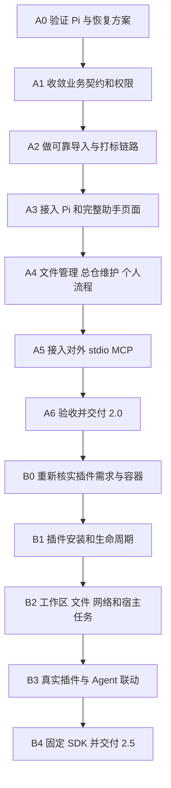

# 08 两个大阶段的开发步骤：2.0 Agent → 2.5 插件

性质：静态开发路线，已纳入本轮逐项确认的 UI、单总仓、删除/移动、迁仓及个人流程决定。本章拥有版本归属、步骤依赖和开发顺序，产品行为只在 [PRD第8节](../../docs/PRD.md#8-20-agent-与25插件的已批准目标待实现) 定义，安全机制在 [06](06-permissions-and-data-safety.md) 定义。原型、生产实现和验收的实际状态只见 [PROJECT_PLAN第9节](../../docs/PROJECT_PLAN.md#9-20-agent开发状态)，不根据本章的未来时态判断是否已有代码。

实施拆分已放到 [任务索引](execution/README.md)：[A0](execution/A0.md)、[A1](execution/A1.md)、[A2](execution/A2.md)、[A3](execution/A3.md)、[A4](execution/A4.md)、[A5](execution/A5.md)、[A6](execution/A6.md) 对应本章2.0阶段；[B卡](execution/B.md) 对应2.5后续阶段。派工方式见 [11](11-execution-guide.md)，不把大阶段直接整包交给执行 AI。

## 1. 两个大阶段与范围

第一大阶段：**2.0 把茶馆做成可实际完成素材任务的垂直 Agent 应用。** 完整复用 Pi SDK，保留手动入口并统一执行 02 已确认的管理规则，通过同一 Rust 业务 Interface 执行素材操作。权限、审批、真实任务状态、恢复是核心功能的一部分。

第二大阶段：**2.5 在已验证的业务基础上实现插件系统。** 第三方网页插件才能在此阶段安装、运行、使用授权文件和网络、维护独立工作空间，并按声明的贡献点被 Agent 调用。

2.0 对插件只预留设计与必要的代码接入位置；不实现插件运行平台，不冻结公开 SDK，不为了未来字段提前建空表。2.5 开始时重新核实依赖、容器方案和用户需求，可以调整目前的插件研究草案。

| 能力 | 2.0 的交付 | 2.5 的交付或复核 |
|---|---|---|
| 对话 Agent | 完整 Pi SDK、助手页面、会话、流式回复、任务/审批卡片 | 接入已批准的插件贡献点 |
| 素材业务 | 查询、导入、入库改名、打标建议与审核、复制导出、库内移动、移入回收站、独立审批清空及任务管理，具体边界见 02/06 | 继续复用，不建立插件专属数据库写入链 |
| 总仓维护 | 单仓托管治理、旧库外记录处置、迁移与重新定位向导、离线保护，均为可信手动维护 | 按真实需求扩展，不默许跨系统搬库 |
| Skills | 内置流程及可保存、命名、编辑参数并再次调用的个人流程，见 02/03 | 扩展至通过审核的插件能力组合 |
| 数据安全 | 主体/范围、计划/批准、幂等、收据、恢复、外发治理 | 追加插件实例、安装身份、工作区和撤权规则 |
| 对外 MCP | 沿用此前需求，核心 Agent 完成后交付受控 stdio 接入 | 根据实际需求扩展；HTTP/远程接入另评估 |
| 插件 Interface | 内部业务契约可扩展；记录未来 Adapter 的接入位置 | 实现宿主、SDK、manifest、容器和贡献点 |
| 导航及百宝箱 | 可自定义的内置快捷入口、居中 Logo；百宝箱为明确「尚未开放」说明页，详见 02；无安装/运行能力 | 百宝箱成为插件中心，增加工作空间、安装启停更新和固定插件入口 |
| 生图、画板、专业 RAW | 保留设计研究；不新增这些引擎/工作流作为 2.0 门槛 | 用真实样例验证插件，媒体能力分批接入 |
| 插件市场/任意后台 JS/自由安装原生扩展 | 不实现 | 独立高级增量，不能阻塞基础插件系统交付 |

上表中的 RAW 是新增专业显影能力；现有 RAW 预览、HEIC/视频处理及原有媒体功能继续保留和回归。外部 MCP Client Broker、任意 Pi extension 和自动下载执行第三方 server 不属于 2.0 核心范围。

## 2. 总体顺序

这是主依赖顺序，不要求所有工程串行。A0 可做只读聊天原型，A1 后可以并行准备聊天 UI；但真实写入必须在 A2 契约通过后接入。A5 可以在 A1/A2 稳定后准备，不能拖延核心 Agent 链路的验证。B 阶段不作为 2.0 的前置开发任务。

旧版 M0–M7 表已由此 A/B 路线替代；实验编号 P01–P06 继续用于 [09](09-validation-and-risk.md)，不再把所有实验一次塞进 2.0。

## 3. 第一大阶段：2.0 素材管理 Agent

### A0 验证关键工程假设

目标：先确认 Pi 能在本应用里受控运行，恢复方案也有可行的最小实现。

工作：

- 固定 Pi/Node 研究基准，做应用专属 sidecar 启动、双向消息、流式返回、停止推理和退出回收原型；不用用户系统 PATH 上不确定的运行时。
- 以模拟模型固定返回工具调用，再接入计划支持的真实模型协议；验证普通推理、压缩、总结、重试与会话重开均走批准的模型传输。
- 用可丢弃交互原型验证 02 的主界面、双导入入口、右侧审核、应用内悬浮助手和可配置底栏，核实最小窗口/DPI/键盘布局；原型不连接真实用户库，也不被当作已交付功能。
- 结合源码调用点检查与运行时出站观察核实网关覆盖，不把静态扫描等同于没有绕过路径的证明；不通过的 provider 不开放。
- 在临时库和测试目录做最小 operation/receipt 原型，覆盖提交后回复前退出、文件已完成但登记未完成的窗口。这是 P03a，不要求先完成整个正式调度器。
- 同时验证单仓身份、旧绝对路径分类和迁仓切换的最小可恢复方案；验证个人模板经参数校验后可由 Pi 加载，并且每次调用仍产生新计划，不能靠上次审批直接执行。
- 清点 Pi 交付依赖里的 JS、WASM、真实原生模块、运行时及附带资源；按实际类型验证摘要、许可与三端可加载性，不把 WASM 自动归类成按平台编译的 native addon。

交付物：原型证据、候选宿主协议、模型传输选型、依赖资产清单、恢复设计结论，以及 [09](09-validation-and-risk.md) 定义的初始8条评估case与批准的资源预算。精确Pi版本及环境/生命周期规则见 [03](03-agent-and-mcp.md)，不得在任务卡中自行跟随latest。

退出条件：P01、P03a、P06 中 Agent sidecar 的部分通过；失败则修订对应 Adapter，不靠放开 shell/SQL 或暴露真实密钥绕过问题。此步骤不开发插件容器或 RAW 引擎。

### A1 收敛领域契约和安全执行规则

目标：让手动界面与 Agent 使用同一业务规则，后续 MCP 和插件也能复用。

工作：

- 从已有 services/db 抽取有真实调用方的 Module；优先搜索、导入、打标建议和任务查询，不批量搬动全仓库。
- 在实施时建立唯一能力词汇与 schema：读操作、prepare、submit、查询/取消分开；prepare 返回 planId，preview 是它的展示内容，不另造一套业务阶段。
- 定义 CallerContext、selectionRef、directoryHandle、planId、operationId 及错误语义；身份由可信 Adapter 构造，未知主体拒绝，前端/模型不能传入自己的权限。
- 定义 ManagedLibrary 的当前身份/定位、托管证据、离线与旧记录待处理状态；迁移/重新定位进入统一维护门。冻结字段布局时考虑现有绝对路径，不把修改 settings.libraryRoot 当迁仓。
- 冻结导入草稿/会话附件/工作台关联、底栏内置贡献项、个人流程模板的实际内部数据契约；不把未来插件运行时提前实现。
- 把计划范围、批准、幂等、权限撤销与库世代落实为后端规则；批准前无执行 operation，批准消费与受理操作在同一短事务完成。
- 明确原 AI batch/export task 持有领域执行状态，operation 持有编排状态；每个状态只由一个位置写入。

交付物：内部契约、定向测试、追加迁移设计、现有界面接入方案。

退出条件：手动 UI 和受控测试 Adapter 使用同一规则；越权、失效范围、伪造 approved=true 被拒绝。只冻结 2.0 实际需要的内部契约，不发布插件 SDK。

### A2 完成第一条可靠业务链路

目标：先让程序可靠完成“导入指定目录 → 对导入成功项生成打标建议 → 用户确认”。暂时不依赖模型是否聪明。

工作：

- 可信选择器授予目录范围；prepare 固定目标、选项和待执行集合，执行前复检变化。
- 先落实单仓范围检查、失联保护及旧库外待处理隔离，使各旧入口不能绕开新规则；启动自动清理必须晚于保护初始化。提供复制回仓/解除关联的可恢复处理，保留现有 asset ID 与元数据。
- 导入增加逐项收据、确定目标和崩溃恢复记录；保留现有去重、文件失败语义与数据库锁外 IO。
- 用真实成功项 Asset ID 形成后续集合，不按导入计数猜测对象。
- 以 `(operationId, stepId)` 唯一关联已有 AI batch；创建子任务和关联原子提交或使用可查询的持久创建键。
- 支持真实进度、部分成功、取消、重启核实；外部结果未知时不自动重新付费请求。
- 引入全局长任务排队、各任务准确取消和持久草稿；独立入库页与未来助手共用领域状态，未知总量不伪造百分比。重开后先恢复摘要，用户继续后才推进效果。
- 建议进入 pending，正式标签仍由可信主界面确认，模型不能替代确认动作。

交付物：已走新契约的手动链路、任务快照、收据、恢复测试。

退出条件：P03b 对该正式链路通过，重复提交不重复导入/创建批次；库恢复、撤权、半复制、磁盘满和回复丢失可解释。通过后才让 Agent 调用真实写工具。

### A3 接入 Pi 并完成助手页面

目标：把 A2 的可靠业务链路变成自然语言可以使用的产品。

工作：

- 正式接入完整 Pi SDK，使用应用专属资源 loader/会话目录；不自动加载素材目录中的指令、用户 Pi extensions 或任意 shell 工具。
- 通过窄宿主协议连接 Rust 与 Pi；主界面经 src/api，不直接控制 Node 或透传 Pi CLI RPC。
- 实现会话列表、流式回复、模型选择、当前素材范围、计划卡片、批准、任务进度和结果跳转。
- 依 02 落实默认五入口与可自定义底栏、可跳过首次引导、左上工作状态和设置；助手三栏、可调宽工作台、历史搜索/改名/归档/删除、最近对话恢复、每会话独立草稿。
- 复用导入和打标审核组件/域状态实现右侧工作台；入库与素材库显式「交给助手」，搜索结果可进入素材库临时结果视图。统一 WebView 拖拽分派，不让聊天附件误触导入或外发。
- 实现可开关的应用内悬浮 Logo、拖动吸附、最近/新建对话与跳转完整审核；不实现桌面级悬浮窗或插件运行容器。
- 用户停止回答与取消业务任务是不同动作，界面说明已执行部分；任务结果取后端，不取模型口头声明。
- 恢复会话时先查询已有 operation；处理 sidecar 崩溃、模型不可用、迟到事件和会话格式升级。
- 凭据仍由后端管理，限流与既有打标/搜索连接共享，增加 Agent 用途绑定及预算约束。

交付物：可实际使用的助手页面及第一条自然语言闭环。

退出条件：一句“导入这个授权目录并为成功项生成标签建议”能完成计划、批准、执行和结果定位；重开聊天不重复写入，关闭聊天不会丢失已受理任务。

### A4 完成文件管理、总仓维护、个人流程和错误处理

目标：覆盖日常素材工作，而不是把所有现有 Tauri commands 全部暴露给模型。

Agent 工具范围由 02/06 定义，在已有链路上补齐复制导出、库内移动、移入回收站与独立清空。所有提交使用 A1/A2 的授权、精确计划及恢复机制；不得原样暴露旧的无批准票据 commands。总仓维护和个人模板管理分别由专属可信 UI 完成，不等于给模型通用文件/代码权限。

工作：

- 搜索复用 SearchPlanV3，处理分页及全选截断；不把全库素材塞进模型上下文。
- A4.1：复制导出、库内移动和移入回收站，补计划、幂等、文件与 DB 收据及恢复；移除所有入口的库外移动追踪语义，目标冲突禁止静默覆盖。
- A4.2：独立清空审批、固定清单和到期清理的宿主维护身份；先通过归属不明/失联/恢复条目/新加入条目测试，才启用真实永久清理。清空 GUI 与普通整理批准明确分开。
- A4.3：完整总仓迁移与重新定位向导，串起 A1 的身份和 A2 的维护保护；空间预检、逐项核验、路径切换、旧句柄失效、源端残留、各中断点恢复均可解释。库外旧记录迁入需保留整理信息，不能因去重跳过而丢数据。
- A4.4：内置流程与个人流程的保存、命名、参数编辑、版本和再次调用；模板实例化后重新取得本次输入与批准。执行记录引用不可变版本；缺失能力/权限/目录不自动继承旧任务。
- 任意原件永久删除、整仓/数据库维护、凭据管理、任意脚本和软件安装不作为 Agent 通用工具；受限清空是专门能力，不是上述限制的隐藏旁路。
- 建立约 30–50 条代表性中文任务评估集，覆盖含糊、纠错、重试、取消、越权和提示注入；记录真实文件/DB 结果。

交付物：明确工具清单、可信维护向导、内置及个人流程管理、用户可见错误/限制、评估结果；A4.1–A4.4 分别按可验证切片交付，不一次提交全部改动。

退出条件：精选功能的业务/权限断言通过；AI 表达质量和工具完成率有真实记录，未支持功能能明确解释而非假装执行。

### A5 复用领域能力提供 stdio MCP

目标：沿用此前“外部助手也能调用茶馆”的需求。它是共享能力的第二个外部 Adapter，不等于插件系统。

工作：配对与主体范围、stdio bridge、现有宿主不可用提示、版本兼容、工具/资源裁剪、任务查询/取消。bridge 不自行开库；外部写请求在茶馆可信界面审批。

交付物：受控 MCP 接入、配置说明、客户端互操作记录。

退出条件：P04 在声明支持的客户端矩阵通过；多 bridge 仍只有一个业务宿主，撤销配对即拒绝后续调用，无 Tasks 客户端仍能查任务。HTTP 远程接入和自动安装外部 server 留待另行设计。

### A6 回归、升级恢复与 2.0 完成检查

目标：确保 Agent 增量没有损坏现有素材管理，并留下足够清晰的 2.5 接入位置。

工作：

- 回归原有导入、浏览、搜索、查看、导出，以及 RAW 预览、FTS、标签、回收站和平台降级。
- 验证新库/旧库追加迁移、备份恢复、同一备份连续恢复及撤权后恢复；使用不可复用库世代，不复活旧授权。
- 按 09 的已确认交互矩阵走查全部入口：无模型手动导入、跨页草稿、排队/恢复、标签审核、归档、底栏配置、悬浮助手及个人流程；用隔离素材覆盖旧库外记录、单仓迁移/失联、受限清空和原文件保留。
- 验证 Pi 会话与任务索引的备份范围、日志脱敏、用户数据清理、sidecar 异常和干净机器启动。
- 完成相应平台门禁和真机证据，遵循现有支持等级；不以 Windows 成功推定三端通过。
- 检查第 5 节预留范围：百宝箱说明页和可配置底栏正常，未来插件可以新增 Adapter 接入业务；当前没有真实插件运行/安装能力、空安装表或尚无消费者的公共 SDK。

2.0 完成标准：A0–A5 的必要条件及上述回归通过；自然语言核心工作流可实际使用，错误/取消/恢复真实，MCP 接入范围明确，插件仅处于设计预留。未完成的插件与新增媒体能力不再阻塞 2.0。

## 4. 第二大阶段：2.5 插件系统

### B0 重新核实方案并验证容器

读取 2.0 的真实契约和用户反馈，重新评估 [04](04-plugin-industry-research.md)/[05](05-plugin-platform.md)，不把早期 manifest 当成已经冻结的协议。优先验证低权限 WebView、主命令 ACL、资源 URL 隔离、CSP、调用身份、焦点与模态窗口。

交付：P02 原型和 PluginContainer 的实际选择。各声明支持的平台必须证明隔离有效；独立窗口降级需明确。插件安全不通过就不安装第三方代码，不回退到在可信主页面执行用户 JS。

### B1 实现安装、启停和生命周期

实现本地网页包验证、安装来源/摘要/签名、权限说明、插件中心、按需激活、关闭/禁用/卸载和版本握手。比较成熟签名工具并明确身份信任策略，不自创签名算法。开发模式仍执行正常权限。

交付：最小 HTML 插件可以安装、打开、保存基础设置、停用和卸载。坏包、路径穿越、未知权限和权限扩大更新被正确处理。先本地包分发，不依赖在线市场上线。

### B2 实现工作区、文件、网络与宿主任务

复用 2.0 的 CallerContext/计划/operations，再增加插件安装和实例身份、独立 namespace、资源句柄、配额、批准连接和后端网络代理。页面关闭后，只有独立授权仍有效的宿主任务继续。

新增工作区/artifact/登记收据，先打通简单 PNG 输出入库；生成和登记分开完成，未保存成果可以持久保留。验证插件撤权、重启、跨实例访问及既有素材 URL 旁路。

交付：受限但完整的 Plugin SDK 内部试用版，能读批准素材、存工程、调用批准服务、保存成果。新增部分补 P03b 恢复验证，不复制另一套业务 importer 或任务系统。

### B3 用真实插件验证 SDK 和 Agent 联动

先完成一个本地画布/处理插件，再完成一个连接已有生图服务的插件；覆盖工程恢复、授权、页面关闭、任务未知状态和成果入库。Agent 只能调用明确声明、可无头执行且经用户允许的贡献点；不默认能操作任意网页 DOM。

RAW 专业显影单独进入 P05/P06：通过的平台/引擎才提供相应插件；不要求先完成 Lightroom 级 UI。若 RAW 适配未通过，不阻塞已经完整验收的基础插件能力，但支持矩阵不能声称已包含它。

交付：至少两个真实样例证明 SDK 实用；新增媒体贡献点有单独的范围和验收记录。通用 native 扩展自由安装仍不是基础 SDK 的必需项。

### B4 固定公开 SDK 并完成 2.5

依据真实样例裁剪并固定 manifest、SDK 和贡献点；交付最小 HTML/TS 模板、构建校验/打包流程、权限文档、兼容策略、更新迁移与工程导出。验证插件更新时旧任务、存储升级失败、撤权和卸载的数据保留。

2.5 完成标准：插件安装→授权→使用→保存→关闭重开→更新/禁用/卸载全程可用；作者能照文档完成自己的插件，用户不需自行安装 Node/Rust；Agent 和插件共用业务规则。2.0 原有流程无回归，插件安全及相关恢复实验通过。

公开市场、任意 headless JS、广泛 native 扩展、远程 MCP Apps、专业 RAW 实时编辑依实际需求另排，不因为本版本叫“插件系统”就默认全包含。

## 5. 2.0 到底预留哪些接口

预留的目标是让 2.5 可以新增 Adapter，而不迫使现在构建未来平台。每一项生产代码抽象应至少有当前手动界面、Agent 或 MCP 的实际用途；只有未来需求的内容先留在设计文档。

| Interface / Seam | 2.0 实现到哪里 | 2.5 才新增什么 |
|---|---|---|
| DomainCapabilities | 明确类型的业务读/prepare/submit，GUI/Agent/MCP 共用 | Plugin SDK 的受控 Adapter |
| CallerContext / Authorization | 当前主体、委托范围、批准/撤权；未知主体拒绝 | 插件安装/实例身份及细分授权，不预发插件凭据 |
| Operations | 业务任务、幂等、取消、快照和恢复 | 插件持久 job 的来源身份和生命周期适配 |
| 选择与资源引用 | Agent/MCP 真正需要的 selectionRef、directoryHandle 与有限素材读取 | WebView 专属资源服务、插件 namespace 和配额 |
| 入库收据 | 导入逐项 Asset ID、恢复与保存事实 | 生成 artifact、配方、衍生关系和工作区 |
| ConversationRuntime | Pi 实例与业务工具注册解耦，SDK 类型不扩散到业务层 | 经过权限校验的插件工具贡献点 |
| UI/平台接点 | 可配置内置导航、百宝箱说明页、助手/手动工作台及统一平台能力 | 插件贡献项固定到底栏、真实插件页面、容器和健康管理 |

不预先实现 `PluginHost` 空壳、通用 `execute(name, anyJson)`、可加载任意模块的 registry、插件安装表、公开 plugin-sdk 包、隐藏常驻 WebView 或未使用的 WASM runtime。生产工具名单在 2.0 是受应用控制的明确集合；不能为了“以后方便”开放动态注册入口。

机器字段和公共协议在 2.5 仍可调整；2.0 的数据不因计划变化被随意破坏。后续破坏性变更应有版本和迁移，而不是承诺一个未经真实插件使用的 SDK 永远兼容。

## 6. 代码和迁移落点

以下均是实施建议，本轮不创建任何这些代码目录或数据库结构。

| 落点 | 版本 | 目的 |
|---|---|---|
| services/operations、authorization、agent_runtime | 2.0 | 持久执行、授权、Pi 生命周期；按行为小步抽取 |
| db/ 与既有 services | 2.0 | 追加迁移、单仓身份/托管映射、旧记录处置、收据、AI/export 关联与个人流程版本，SQL 保持原分层 |
| commands/、src/api、types、stores | 2.0 | 薄入口、领域类型、任务快照，不让组件直调 invoke |
| src/pages、components、packages/agent-host | 2.0 | 02 的助手/导航/工作台/向导/流程管理体验与第一方 SDK Host |
| MCP Adapter / bridge | 2.0 | 复用同一宿主；具体 crate/目录在 A5 确定 |
| services/plugins、packages/plugin-sdk、插件 UI | 2.5 | 安装、容器、SDK、工作区和生命周期 |
| capabilities、permissions、build.rs | 按入口分期 | 2.0 管好当前可信入口；2.5 开放第三方前必须完成全部命令 ACL/资源隔离 |
| artifacts/derivations、媒体 connectors | 2.5 | 生图、画板、RAW；不为了未来功能提前建空表 |

迁移：2.0 只追加 A1–A6 实际使用的单仓身份/托管与待处理映射、授权/计划/操作/收据、会话索引/草稿和个人流程版本结构；保留原领域任务状态所有者。2.5 再追加插件安装、工作区和媒体来源结构。两阶段均不修改已发布迁移，不在数据库锁内做解码/网络/大文件 IO；结构升级与可恢复的数据核验分开，不强制全库文件扫描阻塞启动。未核验项先受保护，不能先放行自动清理再补核验。

## 7. 两阶段共用的工作闭环

每个步骤按“定义行为与范围 → 实现一个可演示切片 → 定向测试 → 相关完整门禁 → 同步权威文档 → 记录真实结果”交付。维护 main，不创建长期平台分支；现有手动工作流始终可回归。

依赖管理：锁定版本用于可复现，不代表永久停更。定期核实 Pi/Tauri/Node 及交付依赖的安全公告；遇适用漏洞评估受影响路径，修复或禁用受影响能力，升级先通过契约/恢复/平台验证。2.5 容器尤其需要验证 unstable API 变化及可用降级路径，不能因兼容困难无限期保留已知可利用问题。

同批实施时同步：产品与导航进 PRD/UI_DESIGN_SYSTEM；Module/数据归属进 ARCHITECTURE；正式能力机器契约进 docs/contracts；实际进度进 PROJECT_PLAN；平台、测试、备份恢复按现有文档职责更新。本目录继续是设计交付，不另开第二份真实进度表。

目前没有原型实测、团队产能和完整估算，不填写假周数或完成百分比。A0 结束后才能估算 2.0 的剩余工作；B0 再估算 2.5。下一项开发工作是 A0，不是先搭插件中心；本次授权仅要求继续完善开发计划，未开始 A0 实现。
